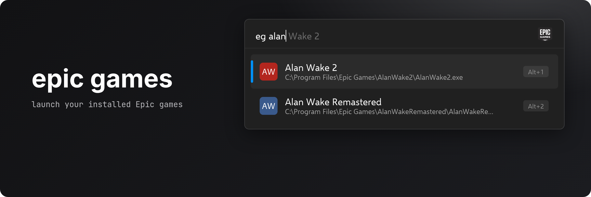

<!-- generated by readwright from docs/README.md.j2; edit the template, not this file -->


# Epic Games Store Launcher

Search and launch your installed Epic Games Store games from Flow Launcher.

[](https://github.com/Garulf/Epic-Games-Store-Launcher/actions/workflows/tests.yml) [](https://github.com/Garulf/Epic-Games-Store-Launcher/releases/latest) [](https://github.com/Garulf/Epic-Games-Store-Launcher/releases/latest)

[](https://www.buymeacoffee.com/garulf) [](https://github.com/sponsors/Garulf)

## Features

* **Search, pick, play.** Select a game and the Epic Games Launcher starts it.
* **Fully local.** Reads the launcher's install manifests from disk. No account, no web requests.
* **Only installed games.** Half finished downloads and installs stay out of the list.
* **Quiet results.** Games that barely match your query are left out. Tune it with a minimum score.

## Usage

Type `eg` followed by a game name, then press `Enter` to launch it:

```
eg alan
```


Type `eg` on its own to list every installed game:


## Installation

### Flow Launcher

In Flow Launcher, type:

```
pm install Epic Games Store Launcher
```


### Manual installation

Download `Epic-Games-Store-Launcher-<version>.zip` from the [latest release](https://github.com/Garulf/Epic-Games-Store-Launcher/releases/latest) and unzip it into
`%appdata%\FlowLauncher\Plugins`, then restart Flow Launcher.

Pre-releases of the next version are published from the open release PR on the
[releases page](https://github.com/Garulf/Epic-Games-Store-Launcher/releases) for testing. Flow Launcher won't offer them as updates.

## Configuration

Open **Settings → Plugins → Epic Games Store Launcher** in Flow Launcher:

| Setting | Default | Description |
| --- | --- | --- |
| Show All when query is empty | on | List every installed game when you type `eg` with nothing after it |
| Minimum score | `10` | Hide games whose match score is at or below this. Raise it if unrelated games show up |

## Requirements

* Windows with the Epic Games Launcher installed
* Flow Launcher 1.17.0 or newer
* Python 3.8 or newer, which Flow Launcher can install for you

## Changelog

### [2.0.0](https://github.com/Garulf/Epic-Games-Store-Launcher/releases/tag/v2.0.0) - 2022-12-22

- Update Flox and use its string matcher

### [1.1.0](https://github.com/Garulf/Epic-Games-Store-Launcher/releases/tag/v1.1.0) - 2022-02-25

- Threshold and empty settings by @Garulf in https://github.com/Garulf/Epic-Games-Store-Launcher/pull/5

### [1.0.3](https://github.com/Garulf/Epic-Games-Store-Launcher/releases/tag/v1.0.3) - 2022-01-12

- Update Flox

See [CHANGELOG.md](CHANGELOG.md) for the full history.
